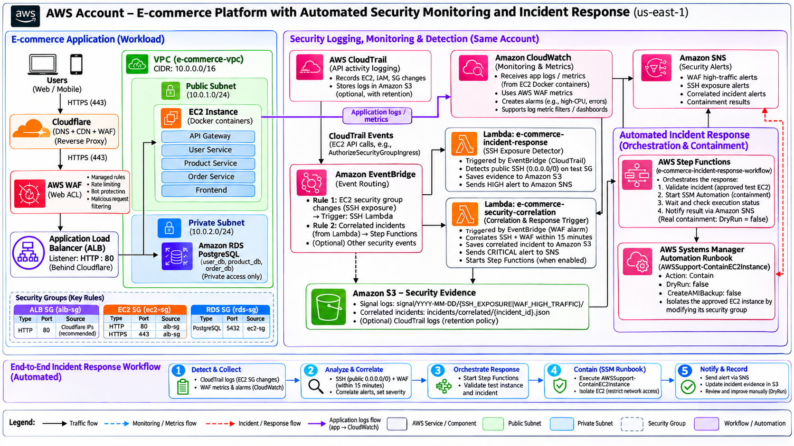

# AWS deployment architecture

## Architecture documented in the project report

The diagram below is taken from the academic project report. It describes the AWS Academy lab deployment in one AWS account, including the e-commerce workload, monitoring and detection services, and the incident-response workflow. It is historical project evidence, not a statement that the AWS resources remain active.

The report records a Cloudflare Worker HTTPS entry point, AWS WAF and an Application Load Balancer routing to Docker Compose application services on Amazon EC2. Amazon RDS for PostgreSQL was placed in private subnets. Amazon Cognito handled authentication. CloudTrail and CloudWatch signals were routed through EventBridge to detection/correlation Lambdas; incident evidence was saved to S3, notifications were sent with SNS, and Step Functions invoked Systems Manager Automation against an approved disposable test instance. The report notes that the Worker-to-ALB origin hop was HTTP and that the production application host was excluded from containment tests.

The report describes a verified academic lab workflow. It does not establish current live status or production assurance. The diagram contains no AWS account number, ARN, resource ID, or credential.

## Conceptual reference diagrams

These older diagrams illustrate a proposed design and logical security zones; they are not the deployed topology above. In particular, their separate application/security account boundary is conceptual. The report documents the lab as a single AWS account.

- [Application and security zones](Architecture_Reference_Application_and_Security_Zones.png)
- [Detailed reference architecture](Architecture_Reference_Detailed.png)

See the [configuration baseline](../06_Configuration/01_AWS_Environment_Baseline.md) for observed configuration and [evidence limitations](../14_Appendices/Evidence_Gaps_and_Interpretation.md) for the scope and limits of assurance.
