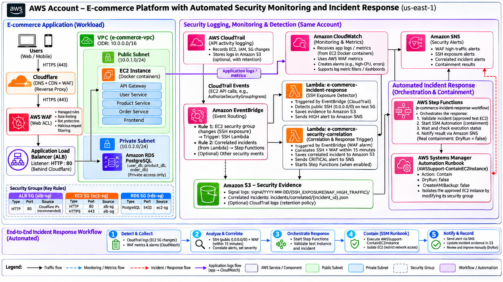
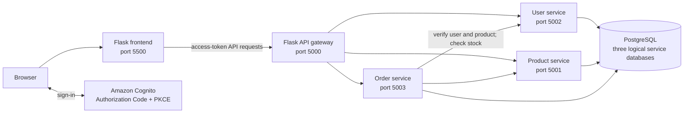

# E-commerce Microservices and AWS Security Audit

A collaborative e-commerce application built from Flask services for users, products, and orders, with a browser frontend, an API gateway, and PostgreSQL. The project was deployed in an AWS Academy lab and extended with monitored security experiments and an orchestrated incident-response workflow. The repository also documents the academic cloud security assessment.

## Architecture

### AWS security architecture

The figure below is taken from the project report and shows the documented AWS Academy lab deployment in a single AWS account. It covers the e-commerce workload, monitoring and detection services, and the tested incident-response path. It describes the lab at the time of the report; it does not mean those AWS resources are still running.



The public entry used a Cloudflare Worker HTTPS endpoint, AWS WAF, and an Application Load Balancer. The report notes that the Worker-to-ALB origin hop used HTTP, so encryption was not end to end. The ALB routed traffic to Docker Compose services on Amazon EC2; Amazon RDS for PostgreSQL ran in private subnets. Amazon Cognito provided authentication.

For the incident-response exercise, CloudTrail and CloudWatch signals flowed through EventBridge to detection and correlation Lambdas. Correlated evidence was stored in S3 and alerts sent through SNS. Step Functions invoked Systems Manager Automation to contain an approved disposable test instance; the production application host was excluded. This was verified in the academic lab, not as a production response service.

### Local Compose architecture



The local Compose stack runs one PostgreSQL container and initializes separate databases for the services. Protected gateway and service routes validate Cognito access tokens; the order service checks user and product information before creating an order and adjusting stock.

## Features

- User, product, and order REST services behind a single API gateway.
- Cognito sign-in using Authorization Code flow with PKCE.
- Access-token validation and user-scoped order access.
- Product stock management and order validation.
- PostgreSQL persistence with service-specific databases.
- Docker Compose for local development.
- A documented AWS cloud security assessment using Prowler and ScoutSuite.

## Technology

| Area | Stack |
| --- | --- |
| Services and gateway | Python, Flask, Flask-SQLAlchemy, REST APIs |
| Data | PostgreSQL, SQLAlchemy |
| Identity | Amazon Cognito, OAuth 2.0 Authorization Code flow with PKCE |
| Frontend | Flask templates, HTML, CSS, JavaScript |
| Local and deployed application | Docker, Docker Compose, Amazon EC2, Application Load Balancer, Amazon RDS for PostgreSQL |
| Identity and edge | Amazon Cognito, Cloudflare Worker, AWS WAF |
| Detection and response lab | CloudTrail, CloudWatch, EventBridge, AWS Lambda, Amazon S3, Amazon SNS, Step Functions, Systems Manager Automation |
| Assessment | Prowler, ScoutSuite, AWS CloudTrail and CloudWatch evidence |

## Run locally

Prerequisites: Docker with the Compose plugin and a Cognito test User Pool/App Client configured for the local callback URL. The application can start without valid Cognito settings, but sign-in and protected requests require a correctly configured pool and client.

```bash
cp .env.example .env
# Edit .env with local-only database values and your Cognito test-client settings.
docker compose up --build
```

Open the frontend at `http://localhost:5500`. The API gateway listens at `http://localhost:5000`; its health endpoint is `http://localhost:5000/health`.

Stop the services while keeping the local database volume:

```bash
docker compose down
```

Do not commit `.env` or put real credentials in `.env.example`. The example file contains placeholders only.

## API surface

The gateway exposes `/health` and routes user, product, and order requests to their corresponding services. The services also define health endpoints. See the service route handlers for the current request and response schemas.

There is no automated application test suite in this checkout. The health endpoint is a basic startup smoke check, not a functional test of authentication, ordering, or AWS resources.

## Security notes

- The browser uses Cognito PKCE and holds the short-lived access token in `sessionStorage`. Browser storage remains accessible to same-origin JavaScript, so protect the frontend against cross-site scripting.
- Protected API and service routes validate Cognito access tokens and use an internal service token for selected service-to-service calls. Configure local values in the ignored `.env` file and use a managed secret store for deployed environments.
- The repository's academic AWS audit recorded **467 Prowler check-resource results** (342 pass, 111 fail, 14 manual), **31 ScoutSuite collection-error records**, and **10 findings**. The audit documents issues including broad SSH exposure, unencrypted EBS, and Cognito MFA not being enforced. Remediation closure is not verified.
- These audit results describe an AWS Academy lab assessment; they are not ISO certification, proof of compliance, or assurance about a current production environment.

See the [AWS Cloud Security Audit overview](AWS_Cloud_Security_Audit/README.md) for scope, methods, evidence limitations, findings, and supporting documents.

## Known limitation

The audit documentation records an OAuth `invalid_scope` response during a deployed HTTPS sign-in check. Confirm that the Cognito App Client allows the configured `openid`, `email`, and `profile` scopes before relying on that flow. This records a prior test result; it does not establish the current state of a live deployment.

## Contributions

This is a collaborative project. My recorded commits include Cognito authentication work, authorization changes to user endpoints, CORS configuration, and adding the cloud security audit materials. The audit documentation credits Wejden Cherif and Maram Raboudi. The repository history is the source for individual code changes; this README does not claim sole authorship.

